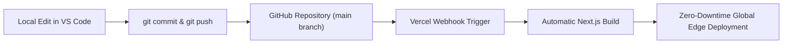

# Complete Vercel Deployment Guide

A step-by-step, beginner-friendly deployment guide for **SIVA INSURANCES & GRANITE SERVICES** (`siva-services` v0.1.0).

---

## Table of Contents
1. [Project Overview & Vercel Compatibility](#section-1-project-requirements)
2. [Prepare the Project Locally](#section-2-prepare-the-project)
3. [Push the Project to GitHub](#section-3-push-the-project-to-github)
4. [Deploy Using Vercel](#section-4-deploy-using-vercel)
5. [Environment Variables](#section-5-environment-variables)
6. [Custom Domain Setup](#section-6-custom-domain-setup)
7. [Post-Deployment Testing & Verification](#section-7-after-deployment)
8. [Updating the Website (CI/CD Workflow)](#section-8-updating-the-website)
9. [Common Deployment Errors & Troubleshooting](#section-9-common-deployment-errors)
10. [Final Deployment Checklist](#section-10-final-deployment-checklist)

---

## Section 1: Project Requirements

Before deploying the website to Vercel, verify that you have the required accounts and software tools installed.

### 1.1 Required Accounts
| Account | Purpose | Cost | Sign-up Link |
| :--- | :--- | :--- | :--- |
| **GitHub Account** | Hosts your source code repository and triggers automatic deployments. | Free | [github.com/signup](https://github.com/signup) |
| **Vercel Account** | Hosts and serves the static production website on a global edge CDN. | Free (Hobby Tier) | [vercel.com/signup](https://vercel.com/signup) |
| **Domain Registrar** (Optional) | For connecting a custom domain (e.g., GoDaddy, Namecheap, Google Domains / Squarespace, Cloudflare). | Varies by domain | Any ICANN-accredited registrar |
| **Formspree Account** | Form submission backend receiving notifications for customer inquiries. | Free / Paid | [formspree.io](https://formspree.io) |

### 1.2 Required Local Software
- **Node.js**: Version `18.18.0` or higher (recommended: Node.js `20.x` LTS or `22.x`).
  - Verify with: `node -v`
- **npm**: Version `9.x` or `10.x` (bundled with Node.js).
  - Verify with: `npm -v`
- **Git**: Installed and configured on your machine.
  - Verify with: `git --version`
- **Code Editor**: Visual Studio Code (or your preferred editor).
- **Web Browser**: Google Chrome, Mozilla Firefox, Microsoft Edge, or Safari.

### 1.3 Technical Architecture Summary
- **Framework**: Next.js 15 (v15.1.7) using the **App Router**.
- **UI Library**: React 19 (v19.0.0).
- **Styling**: Tailwind CSS (v3.4.17) with PostCSS and Autoprefixer.
- **Language**: TypeScript (v5.7.3).
- **Deployment Mode**: Pure Static Site Generation (`output: "export"` in `next.config.ts`).
- **Backend / Database Requirements**: **None**. The website is 100% static and requires zero Node.js server runtimes, serverless compute functions, or external databases.

---

## Section 2: Prepare the Project

Follow these steps on your local machine to verify that the project installs cleanly, passes type checks, and compiles into an error-free production build before uploading to GitHub.

### 2.1 Open the Project in VS Code
1. Launch **Visual Studio Code**.
2. Go to **File** > **Open Folder...** (or press `Ctrl + K, Ctrl + O`).
3. Select the project directory (`D:\BS\BS`).
4. Open the integrated terminal with **Terminal** > **New Terminal** (or press `` Ctrl + ` ``).
5. Verify you are in PowerShell or Command Prompt at the project root.

### 2.2 Install Dependencies
Run the clean installation command to install exact package versions matching `package-lock.json`:
```bash
npm install
```
> **Note**: If you ever switch environments or encounter lockfile synchronization warnings, use `npm ci` for automated builds.

### 2.3 Run the Development Server
Test the application locally to confirm all components and styles render:
```bash
npm run dev
```
Open your browser and navigate to:
```
http://localhost:3000
```
- The root route `/` will automatically redirect to `/en` (or `/ta` if previously saved in localStorage).
- Press `Ctrl + C` in the terminal when you are ready to stop the development server.

### 2.4 Run TypeScript Checks
Verify that there are zero TypeScript compiler errors or type mismatches:
```bash
npx tsc --noEmit
```
*Expected result*: The command should exit with code `0` and print no errors.

### 2.5 Run a Local Production Build
Execute the production build script defined in `package.json`:
```bash
npm run build
```
This runs `next build`. Because `output: "export"` is enabled in `next.config.ts`, Next.js will:
1. Compile and bundle JavaScript, CSS, and assets.
2. Validate TypeScript types.
3. Pre-render all 16 static HTML pages across English (`/en`) and Tamil (`/ta`):
   - `/` (Root locale redirector)
   - `/_not-found` (Custom 404 page)
   - `/en` and `/ta` (Homepages)
   - `/en/about` and `/ta/about` (About page)
   - `/en/contact` and `/ta/contact` (Contact page with general inquiry form)
   - `/en/granites` and `/ta/granites` (Granite overview with quotation form)
   - `/en/granites/catalogue` and `/ta/granites/catalogue` (Stone catalogue explorer)
   - `/en/insurance` and `/ta/insurance` (Insurance services with consultation form)
4. Export the static website files directly into the `out/` directory.

### 2.6 Local Testing of the Static Output (Optional)
To preview the exported static build exactly as a static web server would serve it:
```bash
npx serve out
```
Visit the local URL shown (usually `http://localhost:3000` or `http://localhost:5000`) and test page navigation. Press `Ctrl + C` to stop.

---

## Section 3: Push the Project to GitHub

Vercel deploys directly from GitHub. Follow these steps to connect your local repository to GitHub.

### 3.1 Check Your Current Git Status
Check whether Git is already initialized and whether a remote repository is configured:
```bash
git status
git remote -v
```

- **If `git remote -v` outputs an existing remote repository URL**:
  You already have a remote configured (e.g., `origin https://github.com/akvoraclients/siva-kumar-insurances-and-granite-services.git`). In this case, **do not re-initialize Git** or overwrite the remote. Proceed to Step 3.5.
- **If `fatal: not a git repository` appears**:
  Follow Steps 3.2 through 3.5 below.

### 3.2 Initialize Git (Only if not already initialized)
```bash
git init
git branch -M main
```

### 3.3 Create a Repository on GitHub (If you need a new repository)
1. Go to [github.com/new](https://github.com/new).
2. Repository name: `siva-services` (or your preferred name, e.g., `siva-kumar-insurances-and-granite-services`).
3. Description: `Bilingual Web Platform for SIVA INSURANCES & GRANITE SERVICES`.
4. Choose **Public** or **Private** based on your organization preference (both work on Vercel).
5. **Do not** check "Add a README file", "Add .gitignore", or "Choose a license" (the project already contains these files).
6. Click **Create repository**.

### 3.4 Connect Local Repository to GitHub (Only if setting up a new remote)
```bash
git remote add origin https://github.com/<YOUR-GITHUB-USERNAME>/<YOUR-REPO-NAME>.git
```

### 3.5 Stage, Commit, and Push Changes
Before deploying, ensure your working tree is clean and all changes are pushed:
```bash
# Check modified or untracked files
git status

# Stage all updated files (e.g., VERCEL_DEPLOYMENT.md)
git add .

# Create a clear, descriptive commit
git commit -m "docs: add comprehensive Vercel deployment documentation"

# Push to the main branch on GitHub
git push -u origin main
```
*(If the branch was already pushed previously, a standard `git push` is sufficient).*

### 3.6 Verify on GitHub
1. Open your repository page in your browser: `https://github.com/<YOUR-USERNAME>/<YOUR-REPO-NAME>`.
2. Confirm that:
   - Branch `main` is selected as the default branch.
   - The latest commit appears at the top.
   - Files like `src/`, `public/`, `package.json`, `next.config.ts`, and `VERCEL_DEPLOYMENT.md` are visible.
   - The `.next/` and `out/` folders are **not** present (they are properly ignored by `.gitignore`).

---

## Section 4: Deploy Using Vercel

Once your code is on GitHub, deploying to Vercel takes less than three minutes.

### 4.1 Sign in to Vercel
1. Open [https://vercel.com/](https://vercel.com/) in your browser.
2. Click **Log In** in the top-right corner.
3. Select **Continue with GitHub**.
4. Authorize Vercel to access your GitHub account.

### 4.2 Import the Project
1. Once logged into your Vercel Dashboard, click the **Add New...** button in the upper-right corner and select **Project**.
2. In the **Import Git Repository** list, find your repository (`siva-services` or `siva-kumar-insurances-and-granite-services`).
   - *Tip*: If the repository is not listed, click **Adjust GitHub App Permissions** and grant Vercel access to the repository.
3. Click the **Import** button next to your repository name.

### 4.3 Configure Project & Build Settings
Vercel analyzes the repository automatically. Verify each setting carefully:

| Setting | Value / State | Action Required |
| :--- | :--- | :--- |
| **Project Name** | `siva-services` (or custom name) | Keep default or rename to your liking. |
| **Framework Preset** | **Next.js** | **Keep Default**. Vercel will automatically detect Next.js. |
| **Root Directory** | `./` | **Keep Default** (leave untouched). |
| **Build Command** | `next build` | **Keep Default** (do not override). |
| **Output Directory** | Automatically managed | **Keep Default** (leave toggle OFF). |
| **Install Command** | `npm install` | **Keep Default** (leave toggle OFF). |
| **Node.js Version** | `20.x` or `22.x` | Automatically set in Project Settings. |

> **IMPORTANT: Why keep default settings?**  
> Even though `next.config.ts` includes `output: "export"`, Vercel's official Next.js deployment engine natively understands this directive. When Framework Preset is set to **Next.js**, Vercel runs `next build`, locates the exported files, and configures edge caching and static routing headers automatically. **Do not override the output directory to `out` manually** unless you are deliberately deploying under the "Other" framework preset.

### 4.4 Environment Variables Section
For this project, expand the **Environment Variables** section if needed, but note:
- **No environment variables are required** for initial deployment.
- Leave this section blank for now (see [Section 5](#section-5-environment-variables) for details).

### 4.5 Deploy
1. Click the blue **Deploy** button.
2. Vercel will initiate the deployment process:
   - **Cloning repository**: Fetches the latest commit from `main`.
   - **Running build command**: Executes `npm install` and `next build`.
   - **Compiling static pages**: Generates all 16 localized routes.
   - **Assigning domains**: Provides a free `*.vercel.app` production URL.
3. Wait approximately 45–75 seconds.
4. When deployment completes, you will see confetti and a preview card saying **"Congratulations! You just deployed a new project to Vercel."**

### 4.6 Open and Verify the Deployed Website
1. Click the preview screenshot or the link below it (e.g., `https://siva-services.vercel.app`).
2. Verify that the homepage loads instantly and redirects smoothly to `/en/` or `/ta/`.

---

## Section 5: Environment Variables

Understanding how configuration and secrets are handled in this codebase.

### 5.1 Are Environment Variables Required?
**No mandatory environment variables are currently required.**

The website is architected with client-side form submissions and static data constants. Here is the exact breakdown:

### 5.2 Formspree Endpoint Configuration
In the current codebase, the Formspree submission endpoint is configured in `src/lib/constants.ts`:
```typescript
// Line 62 of src/lib/constants.ts
export const FORMSPREE_ENDPOINT = 'https://formspree.io/f/xqppwdnq';
```
All three enquiry forms import this constant directly:
- `EnquiryForm.tsx` (General enquiry form on `/contact`)
- `GraniteEnquiryForm.tsx` (Granite quotation form on `/granites`)
- `InsuranceEnquiryForm.tsx` (Insurance consultation form on `/insurance`)

Because this endpoint is compiled directly into the static bundle, **the website deploys and functions immediately without configuring any environment variables in Vercel**.

### 5.3 Optional: Future Environment Variable Setup (Best Practice)
If in the future you wish to change the Formspree endpoint or other settings dynamically between environments without editing TypeScript code:

1. **Local `.env.local` File** (Add to project root, never commit to git):
   ```env
   NEXT_PUBLIC_FORMSPREE_ENDPOINT=https://formspree.io/f/xqppwdnq
   NEXT_PUBLIC_SITE_URL=https://sivaservices.in
   ```
2. **Adding to Vercel Dashboard**:
   - Go to your project on Vercel.
   - Click **Settings** > **Environment Variables**.
   - **Key**: `NEXT_PUBLIC_FORMSPREE_ENDPOINT`
   - **Value**: `https://formspree.io/f/your_form_id`
   - **Environment**: Select all: **Production**, **Preview**, **Development**.
   - Click **Save**.
   - Trigger a new deployment (**Deployments** > **...** > **Redeploy**) to bake the environment variable into the static export.

> **Security Reminder**:
> - Never expose secret API keys, private passwords, or payment tokens in variables starting with `NEXT_PUBLIC_`.
> - The Formspree endpoint URL is meant to be public because client browsers submit forms directly to it.
> - Form submissions are secured via Formspree's server-side honeypot filtering and domain allowlisting.

---

## Section 6: Custom Domain Setup

By default, Vercel gives you a subdomain such as `https://siva-services.vercel.app`. To connect your official brand domain (e.g., `sivaservices.in` or `www.sivaservices.in`):

### 6.1 Add Domain in Vercel
1. Log in to [Vercel Dashboard](https://vercel.com/) and select your project.
2. Navigate to **Settings** > **Domains**.
3. In the input field, enter your domain name (e.g., `sivaservices.in`) and click **Add**.
4. Vercel will ask how you want to handle the `www` subdomain:
   - **Recommended Choice**: Select **"Add sivaservices.in and redirect www.sivaservices.in to it"** (or vice versa).
   - This ensures all visitors reach the same canonical URL without duplicate content penalties.

### 6.2 Configure DNS Records at Your Registrar
Log in to the DNS management panel where you purchased your domain (GoDaddy, Namecheap, Cloudflare, etc.) and add the following records:

#### Option A: Root Domain (`sivaservices.in`)
Add an **A Record**:
- **Type**: `A`
- **Name / Host**: `@` (or leave blank depending on your registrar)
- **Value / Destination**: `76.76.21.21`
- **TTL**: `Automatic` or `3600 seconds` (1 hour)

#### Option B: Subdomain or `www` (`www.sivaservices.in`)
Add a **CNAME Record**:
- **Type**: `CNAME`
- **Name / Host**: `www`
- **Value / Destination**: `cname.vercel-dns.com.`
- **TTL**: `Automatic` or `3600 seconds` (1 hour)

### 6.3 DNS Propagation & Automatic SSL
- **Verification**: Once records are saved, return to Vercel Settings > Domains. The status indicator will transition from a blue or yellow warning icon to a green checkmark **"Valid Configuration"**.
- **Propagation Time**: DNS changes typically take between **5 minutes to 2 hours** to update worldwide, though in rare cases up to 24–48 hours depending on registrar TTL.
- **Automated SSL Certificate**: Vercel automatically generates and renews a free **Let's Encrypt SSL/TLS Certificate** for your domain. HTTPS is enforced automatically with zero manual server configuration.

---

## Section 7: After Deployment

Run through this quality assurance checklist on your live production URL.

### 7.1 Verify Language Routes & Localization
1. Navigate to the root URL: `https://your-domain.vercel.app/`.
2. Confirm the browser smoothly redirects to `/en/`.
3. Click the **Language Switcher** button (`EN | தமிழ்`) in the header:
   - Verify the URL changes to `/ta/` while remaining on the same page.
   - Verify all Tamil typography, headlines, labels, and badges render crisply.
4. Refresh the page: Verify the chosen language is remembered via `localStorage`.

### 7.2 Verify Responsive Navigation
- **Desktop**: Check that the navigation bar displays all links (Home, Insurance, Siva Granites, Granite Catalogue, About, Contact) and the phone CTA buttons.
- **Mobile**: Open the website on an Android or iOS smartphone (or use Chrome DevTools Device Mode):
   - Open and close the mobile slide-over drawer menu.
   - Verify the bottom sticky contact bar (`QuickContactButtons.tsx`) is visible, accessible, and does not block page content.

### 7.3 Test All Three Enquiry Forms Safely
The website has three forms submitting to Formspree with built-in client-side honeypot spam protection:

| Form | Location | Purpose | Fields to Test |
| :--- | :--- | :--- | :--- |
| **General Enquiry** | `/en/contact` and `/ta/contact` | General inquiries | Name, Phone (+91 format), Email, Service selection, Message |
| **Granite Quotation** | `/en/granites#enquiry` | Stone orders & pricing | Name, Phone, District, Stone Colour, Finish, Area (sq. ft.) |
| **Insurance Consultation** | `/en/insurance#enquiry` | Policy advice | Name, Phone, District, Insurer (LIC/Star/New India), Policy type |

#### How to test without sending spam:
1. **Validation Test**: Leave the Name or Phone field blank and click Submit.
   - Confirm a friendly validation error appears ("Please provide your name and phone number").
2. **Short Number Test**: Enter a 4-digit phone number and submit.
   - Confirm the phone length validation prevents submission.
3. **Real Submission Verification**:
   - Fill in a legitimate test submission with your own name, phone number, and a note: *"Test submission from Vercel deployment verification"*.
   - Submit the form.
   - Verify the green success confirmation appears and the form inputs clear.
   - Check the Formspree dashboard or the destination inbox (`sivakumarpriya9894@gmail.com`) to confirm email receipt.

### 7.4 Test Phone, WhatsApp, and Address
1. **Primary Phone Link**:
   - Click `+91 98948 29633`.
   - On a mobile device, this should prompt the native phone dialer with `tel:+919894829633`.
2. **Secondary Phone Link**:
   - Click `+91 90804 45622`.
   - Verify the dialer opens with `tel:+919080445622`.
3. **WhatsApp Link**:
   - Click the WhatsApp Chat button.
   - Verify it opens `https://wa.me/919894829633` with the pre-filled localized message (e.g., *"Hello Siva Kumar, I am contacting you through the SIVA INSURANCES & GRANITE SERVICES website."*).
4. **Office Address**:
   - Verify the address is displayed accurately:  
     `Sai Venture Layout, Near Sathyanarayana Temple, Hosur - 635109, Tamil Nadu, India.`
   - Searching this address on Google Maps points directly to Hosur, Tamil Nadu.

### 7.5 Inspect Images and Performance
- Verify that the owner profile image (`/images/siva-kumar/sivakumar.webp` and `sivakumar.png`) loads crisply on the About page and Home page.
- Verify that granite category illustrations (`black-granite.svg`, `brown-granite.svg`, etc.) load without broken image icons.
- Verify that the favicon (`/favicon.svg` and `/favicon.ico`) appears in the browser tab.

### 7.6 Review Vercel Deployment Logs
1. Go to your Vercel Dashboard.
2. Select your project and click the **Deployments** tab.
3. Click the active deployment.
4. Select **Building** under the Deployment Status to view the complete build log:
   - Confirm `✓ Generating static pages (16/16)` succeeded.
   - Check that there are zero warnings or unhandled exceptions.

---

## Section 8: Updating the Website

Once deployed, keeping the website updated is completely automated through Git.

### 8.1 The Automatic Git CI/CD Workflow
Every time you push new code to the connected GitHub repository, Vercel automatically triggers a new production build:



#### Step-by-Step Update Routine:
1. Make your code or content changes locally in VS Code (e.g., updating a phone number in `src/lib/constants.ts` or adding a new stone variety in `src/lib/granite-catalogue.ts`).
2. Test locally:
   ```bash
   npm run build
   ```
3. Commit and push:
   ```bash
   git add .
   git commit -m "update: refresh granite catalog pricing"
   git push origin main
   ```
4. Within seconds, Vercel detects the push, builds the project, and updates the live production site with **zero downtime**.

### 8.2 Preview Deployments for Branches
If you want to test new features or design changes before making them public:
1. Create a new branch:
   ```bash
   git checkout -b feature/new-page
   ```
2. Make changes, commit, and push the branch:
   ```bash
   git push origin feature/new-page
   ```
3. Vercel will create a unique **Preview Deployment URL** (e.g., `https://siva-services-git-feature-new-page-yourname.vercel.app`).
4. You can share this URL with clients or team members for review.
5. Once approved, merge the branch into `main` via a GitHub Pull Request or command line, and Vercel will automatically promote it to the production URL.

### 8.3 How to Inspect Failed Deployments
If a build fails (e.g., due to a syntax error or broken TypeScript interface):
1. The previous production deployment **remains live and uninterrupted**; your visitors will never see a broken site.
2. Go to Vercel Dashboard > **Deployments**.
3. Failed deployments are marked with a red status dot.
4. Click on the failed deployment and inspect the build logs. Vercel highlights the exact file and line number causing the issue.

### 8.4 Instant Rollbacks
If an unwanted change accidentally makes it to production:
1. In Vercel Dashboard, go to the **Deployments** tab.
2. Find the previous stable deployment in the list.
3. Click the three dots icon (`...`) on the right side of that deployment.
4. Select **Instant Rollback**.
5. Within 5 seconds, Vercel points your custom domain back to that previous build.

---

## Section 9: Common Deployment Errors & Troubleshooting

Practical solutions tailored specifically to this project's Next.js and static export architecture.

### 9.1 Issue: Build Failure — "Type error in component"
- **Cause**: A TypeScript interface mismatch or missing property in components or dictionaries.
- **Fix**: Run the TypeScript compiler locally before pushing:
  ```bash
  npx tsc --noEmit
  ```
  Fix any highlighted type errors, then commit and push.

### 9.2 Issue: Localized Routes Return 404 on Refresh (`/en` or `/ta`)
- **Cause**: In dynamic server apps, localized dynamic routes need runtime rewriting. In our static export architecture, Next.js generates physical directories (`out/en/index.html` and `out/ta/index.html`).
- **Fix**: 
  - Ensure `trailingSlash: true` is present in `next.config.ts` (this is already configured).
  - Ensure `generateStaticParams()` in `src/app/[lang]/layout.tsx` returns both locales:
    ```typescript
    export function generateStaticParams() {
      return [{ lang: 'en' }, { lang: 'ta' }];
    }
    ```
  - When Framework Preset is set to **Next.js**, Vercel automatically maps `/en/` and `/ta/` to their respective static HTML pages.

### 9.3 Issue: Missing Images After Deployment
- **Cause**: Next.js Image Optimization service fails when deploying static export unless unoptimized mode is enabled, or image paths use incorrect relative paths.
- **Fix**:
  - Verify that `next.config.ts` includes:
    ```typescript
    images: {
      unoptimized: true,
      dangerouslyAllowSVG: true,
    }
    ```
    *(Already configured in the codebase).*
  - Verify all image paths start with a leading slash `/` referencing the `public` directory (e.g., `/images/siva-kumar/sivakumar.webp`, not `images/siva-kumar/...` or `../public/...`).

### 9.4 Issue: Form Submissions Fail or Show Network Error
- **Cause**: Formspree endpoint URL is malformed, client has an aggressive ad-blocker blocking external form submissions, or Formspree domain restriction is active.
- **Fix**:
  - Verify that `FORMSPREE_ENDPOINT` in `src/lib/constants.ts` is a valid Formspree URL:
    `https://formspree.io/f/xqppwdnq`
  - In your Formspree dashboard, check **Settings** > **Allowed Domains**. Ensure your new Vercel domain (`*.vercel.app` and your custom domain) is included in the allowed domains list so submissions are not rejected with a `403 Forbidden` error.

### 9.5 Issue: Custom Domain Stuck on "Pending Verification"
- **Cause**: DNS records have not propagated yet, or there is a conflicting DNS record (e.g., an old A record or AAAA record from a previous host).
- **Fix**:
  - Check your domain's live DNS records using an online tool such as [whatsmydns.net](https://www.whatsmydns.net/).
  - Ensure there is only **one** A record for `@` pointing to `76.76.21.21`. Remove any duplicate A records pointing to old web hosts.
  - If using Cloudflare DNS, ensure the proxy status is set to **DNS Only** (grey cloud icon) during initial verification so Vercel can issue the Let's Encrypt certificate.

---

## Section 10: Final Deployment Checklist

Print or reference this checklist before and after deploying your site.

### Pre-Deployment Checks (Local Machine)
- [ ] Dependencies install cleanly with `npm install`.
- [ ] TypeScript type check passes with `npx tsc --noEmit` (0 errors).
- [ ] Production build succeeds with `npm run build` (0 errors).
- [ ] All 16 static HTML pages generate successfully in the build summary.
- [ ] Git working directory is clean (`git status` shows nothing to commit).
- [ ] Code is pushed to GitHub `main` branch (`git push origin main`).
- [ ] GitHub repository contains latest files (`src/`, `public/`, `package.json`, `next.config.ts`).
- [ ] Sensitive files (`.env`, `.env.local`, `node_modules/`, `.next/`, `out/`) are excluded by `.gitignore`.

### Deployment Settings (Vercel Dashboard)
- [ ] Signed into Vercel using the GitHub account hosting the repository.
- [ ] Project imported from the correct GitHub repository.
- [ ] Framework Preset is set to **Next.js**.
- [ ] Root Directory is set to `./` (default).
- [ ] Build Command is `next build` (default).
- [ ] Output Directory toggle is left OFF (automatically managed).
- [ ] Blue **Deploy** button clicked.
- [ ] Deployment finishes with status **Ready** (green checkmark).

### Post-Deployment Verification (Live URL)
- [ ] Root URL (`/`) automatically redirects to `/en/`.
- [ ] Language Switcher switches seamlessly between English (`/en/`) and Tamil (`/ta/`).
- [ ] Tamil font, text, and layout render without rendering artifacts.
- [ ] All pages load without 404 errors (`/about`, `/contact`, `/granites`, `/granites/catalogue`, `/insurance`).
- [ ] Primary phone button opens dialer with `+91 98948 29633`.
- [ ] Secondary phone button opens dialer with `+91 90804 45622`.
- [ ] WhatsApp button opens WhatsApp chat with pre-filled message.
- [ ] Office address in Hosur displays properly on Contact page and Footer.
- [ ] General Enquiry form validation functions properly.
- [ ] Test form submission successfully arrives in Formspree / email.
- [ ] Granite quotation and Insurance consultation forms render and validate properly.
- [ ] All images, icons, and favicons load crisply without 404s.
- [ ] Mobile view displays responsive layout and bottom quick-contact action bar.
- [ ] Custom domain configured with A and CNAME DNS records (if applicable).
- [ ] HTTPS / SSL padlock is active and secure in browser address bar.

---

*Documentation prepared for SIVA INSURANCES & GRANITE SERVICES (`siva-services`).*
